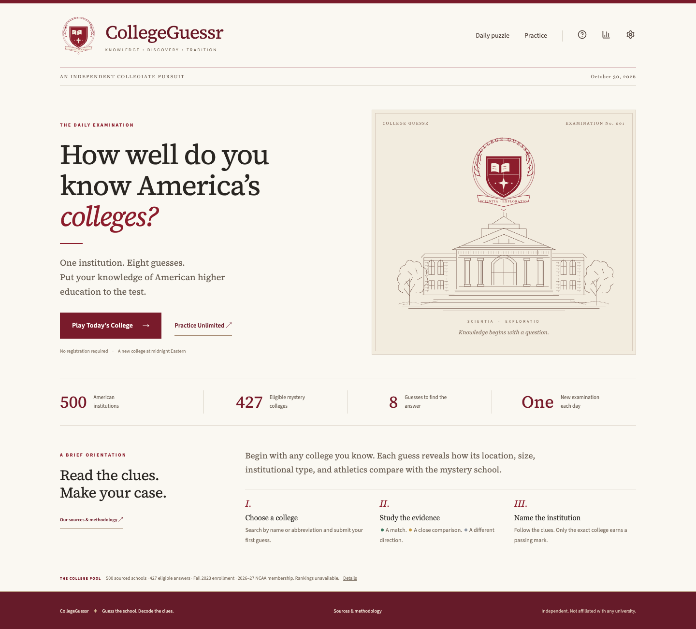

# CollegeGuessr

Guess the school. Decode the clues.

A React + TypeScript + Vite static college guessing game, with an original SVG academic crest, crimson and parchment academic design, responsive clue cards, fuzzy college search, Daily and unlimited Practice.

**Status: working v1 with a documented data limitation.** There are 500 real IPEDS institutions and **427 eligible mystery answers**, exceeding the minimum 250. The remaining 73 lack an unambiguous current NCAA match and cannot become mystery answers. All numeric rankings remain unavailable because no licensed ranking source was imported; ranking clues display neutral N/A. Enrollment is sourced from Fall 2023, athletics from the official NCAA 2026–27 active-member directory. No statistics or rankings are fabricated.



## Run locally

Node 22.12+ recommended.

```sh
npm ci
npm run dev
npm run build
npm run preview
npm test
npm run test:e2e
npm run audit:data
node scripts/validate-data.mjs --production
```

The last command enforces the 250 verified-answer minimum. It passes for the committed dataset. Install Chromium for browser tests with `npx playwright install chromium`. Tests run desktop and 375px mobile viewports. Screenshots are saved under `screenshots/`.

## Features

- Daily: eight guesses, Eastern calendar, deterministic frozen schedule, next-midnight countdown, local saved rounds, cross-tab progress updates.
- Practice: unlimited guesses and new rounds, avoiding immediate repeats.
- Search: fuzzy names and aliases, eight results, keyboard arrows/Enter/Escape, duplicate filtering. Ambiguous abbreviations require explicit selection.
- Six comparison functions, with unavailable data rendered neutral. Enrollment/rank arrows and hard mode preference.
- Win/loss reveal, native share or clipboard, answer-free emoji grids, manual text fallback.
- Daily win distribution, win-only average, Eastern streaks, practice solved counts.
- Dark appearance, animation preference, system reduced-motion support, permanent non-color symbols, modal focus handling, reset confirmation.
- Original vector crest, horizontal wordmark variants, favicon and social artwork.

Not implemented: speedrun, conference challenge, audio, accounts, backend, licensed numeric rankings. First-time players see an inline introduction; detailed rules remain available in the help menu. Search highlights name substrings; alias-only matches display the full institutional name.

## Data and selection

Sources: [IPEDS HD2023](https://nces.ed.gov/ipeds/datacenter/data/HD2023.zip), [EF2023A](https://nces.ed.gov/ipeds/datacenter/data/EF2023A.zip), [IC2023](https://nces.ed.gov/ipeds/datacenter/data/IC2023.zip), and its published [dictionary](https://nces.ed.gov/ipeds/datacenter/data/IC2023_Dict.zip).

Enrollment is **Fall 2023 total fall enrollment**, EF2023A EFALEVEL=1, EFTOTLT. The 2024 bulk fall-enrollment download endpoint returned HTTP 404 during collection, so the reliably accessible 2023 snapshot is used. Ownership and institutional identity come from HD2023. Stable IDs are IPEDS UNITIDs. IPEDS enrollment values can include NCES imputations; the current import does not label imputation flags separately, which needs attention before production verification.

This is a **curated college pool**, not an official top-500 ranking. Filter HD2023 for four-year undergraduate institutions with public/private nonprofit control, in the states/DC, Carnegie 2021 basic classifications 15–23, and positive enrollment. Prioritize classification 21 (baccalaureate arts/sciences), then 15/16 (R1/R2), then remaining classifications. Within priority groups sort descending enrollment, UNITID breaks ties. Take 500. This favors recognized research institutions and liberal arts colleges while retaining regional institutions; it does not guarantee every example in the original brief. The per-record selectionReason and classification fields form the reproducible inclusion manifest.

All rank fields are null: no licensed comparable ranking source was imported. Historical basketball conference labels from IC2023 CONFNO2 remain audit-only. Current NCAA association, division and primary conference come from the [official NCAA active-member feed](https://web3.ncaa.org/directory/api/directory/memberList?type=1), academicYear 2027 (2026–27), retrieved October 30, 2026. The public directory presents these as the institution's conference, separately from sport-specific memberships. A unique match requires identical state and normalized exact institutional name or exact website host. Ambiguous or absent matches remain ineligible. `athleticsManifest.json` records each of the 427 joins, NCAA organization ID, source name, division, conference and source URL. Empty conferences mean Independent according to the directory's own rendering. See DATA-QUALITY.md.

To update, create a Python virtual environment, install `openpyxl`, then run `python scripts/import-ipeds.py`. It downloads the specified public NCES files to ignored scripts/cache/. The importer is pinned to the documented 2023 edition. Update field mappings and source year together when adopting a newer edition. Then run `python scripts/import-athletics.py` to download the official NCAA directory and merge unique matches. Delete the ignored NCAA cache file before refreshing the feed; review academicYear and matching changes before accepting a new season. Never infer primary conference from football or basketball without verification. Re-run audits and review diffs. Neither importer overwrites the production schedule-v1.json. The athletics importer creates it only if absent. Preserve published schedules and all referenced IDs.

## Comparison rules

- State: same green, adjacent gold, other gray. DC neighbors MD/VA. The adjacency map includes shared water boundaries for IL/MI, MI/MN and NY/RI, and Four Corners contacts AZ/CO and NM/UT; excludes RI/NJ and MI/OH lake-only additions beyond their existing land boundary. The map is manually encoded and symmetry tested; an authoritative source audit remains required before production.
- Type: same green, different gray.
- Enrollment: absolute difference ≤2,500 green, ≤10,000 gold, otherwise gray. Arrow points toward mystery value.
- Rank: same source/year/category only; ≤10 green, ≤25 gold, otherwise gray. ↑ means higher numeric/worse rank. Missing/incompatible rankings are neutral.
- NCAA division: same green, I/II or II/III gold, I/III gray. Different known associations gray; unknown fields neutral.
- Conference: same verified conference and NCAA division green; different conference in same division gold; different divisions gray. Missing fields neutral.

Only an exact ID wins. Invalid or repeated guesses consume no attempts. Tooltip differences disclose relative distances, never the hidden school's direct value. A static game is not cheat-proof.

## Daily schedule and persistence

Epoch: October 30, 2026, puzzle #1. America/New_York defines the date. `schedule-v1.json` is a committed, fixed permutation of the 427 eligible IDs, generated with Python Random(827631). The index advances once per Eastern calendar day, cycling after 427 days, with no repeats less than 427 days apart. Preserve the file and all referenced institution IDs across future imports; the v1 storage namespace is separate from the early preview. Progress uses localStorage `cg-v1-*`; no account or server sync is provided. LocalStorage failures leave the session playable. Concurrent tab submissions are last-write-wins; the app synchronizes storage events but does not provide transactional locking.

## Deployment preparation

`vercel.json` sets the Vite build and dist output; hash routes avoid deep-link routing requirements. Connect the private GitHub repository to Vercel, use `npm ci` / `npm run build`, review the documented data limitations, and publish after explicit authorization. No environment variables are required. No domain has been purchased or assumed available. No production site is deployed.

Both SVG artwork and a 1200×630 PNG Open Graph image are included. Configure an absolute canonical deployment URL and og:image URL before public launch. Fonts load from Google Fonts with system fallbacks. CSS is custom rather than Tailwind; animations use CSS rather than Motion to keep runtime dependencies small.

CollegeGuessr is independently developed and is not affiliated with any listed university, conference, ranking organization or NCES. NCES source data is attributed above. Branding artwork is original to this project.


## GitHub Pages

The live site is https://ornsteinfx.github.io/collegeguessr/. GitHub Pages must use **GitHub Actions** as its publishing source. `.github/workflows/pages.yml` installs dependencies, runs unit tests, builds Vite with `--base=/collegeguessr/`, and deploys the compiled `dist` artifact. Never publish the repository root as an unbuilt static site: browsers cannot execute the TypeScript/React entry point directly. All public assets resolve through Vite's configured base path. Local and Vercel builds retain the default `/` base. The round identifier also falls back safely when `crypto.randomUUID` is unavailable.
